# Кейсы: Blender и программирование для VR на Python

## Часть 1. Работа с Blender (Python API bpy)

### Кейс 1. Создание примитива для VR-сцены
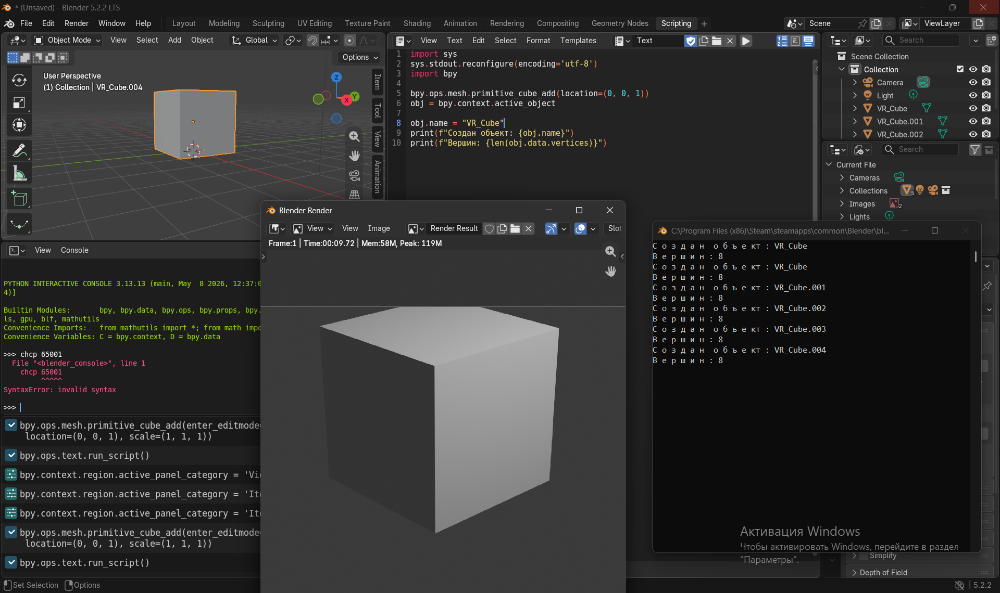

### Кейс 2. PBR-материал для объекта (Principled BSDF)
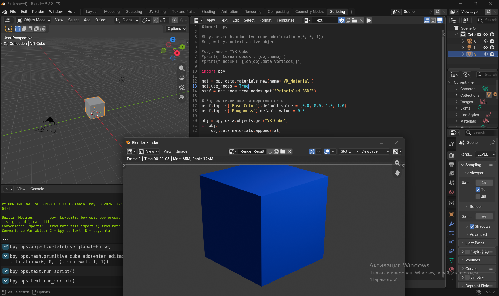

### Кейс 3. Настройка стереокамеры для VR (multiview)
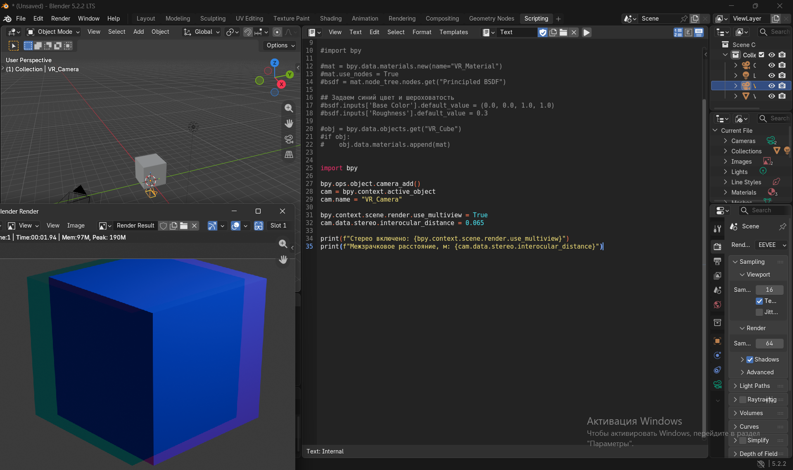

### Кейс 4. Оптимизация меша под 90 FPS (модификатор Decimate)
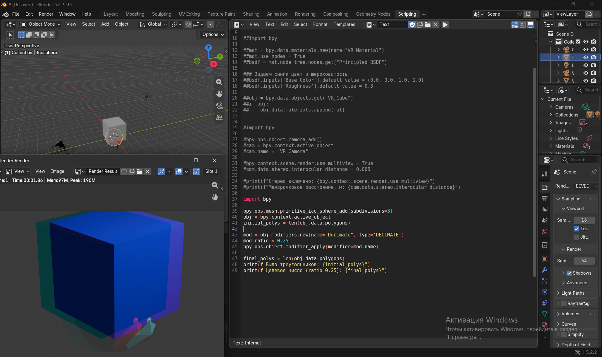

### Кейс 5. Инстансинг: расстановка объектов циклом
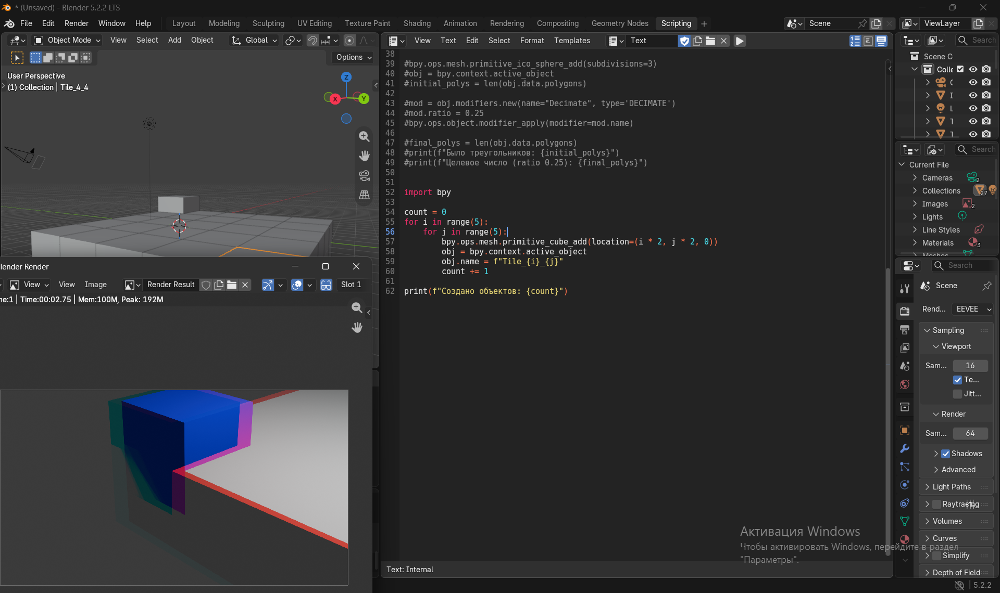

### Кейс 6. Освещение VR-сцены (источник Sun)
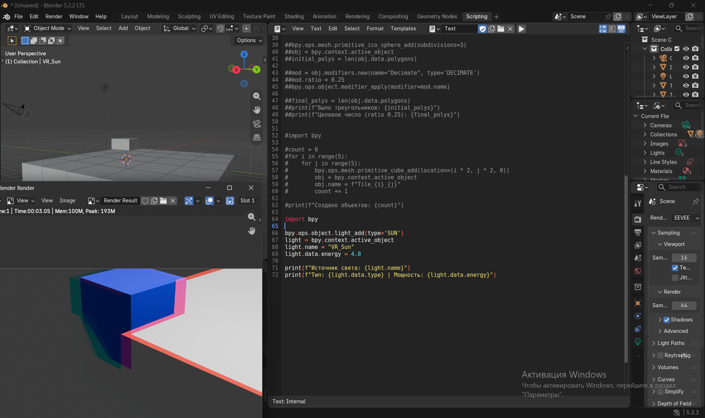

### Кейс 7. Анимация вращения (ключевые кадры)
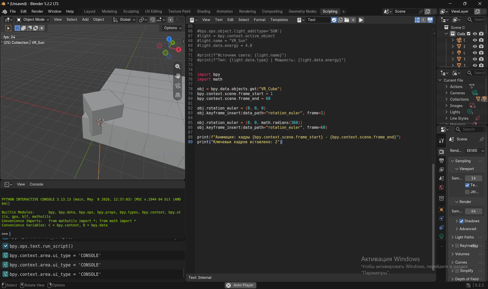

### Кейс 8. Экспорт сцены в gITF (GLB) для VR-движка
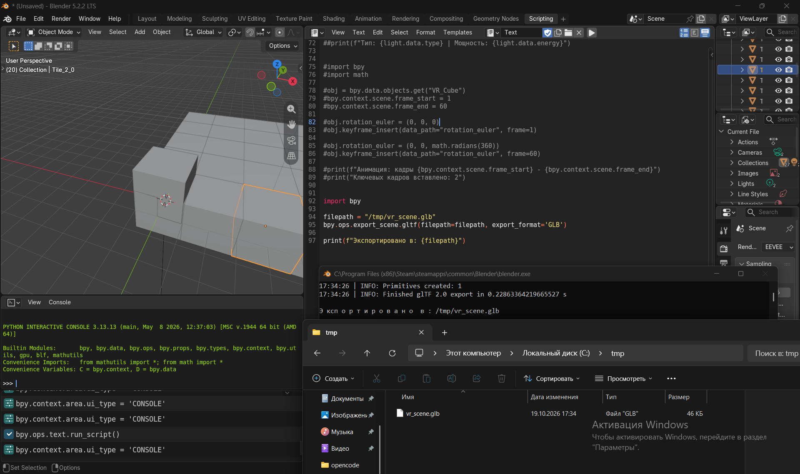

---

## Часть 2. Программирование для VR (расчёты на Python)

### Кейс 9. Стереокамеры: расчёт позиций левого и правого глаза
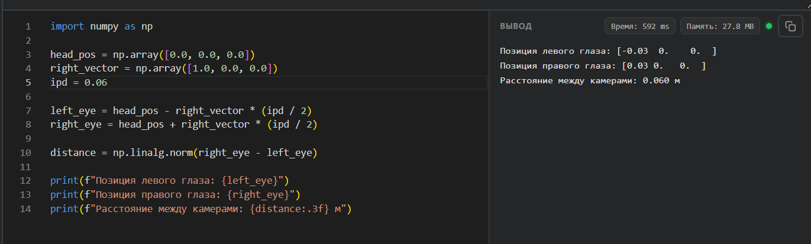

### Кейс 10. Поле зрения (FOV) и размер объекта в кадре
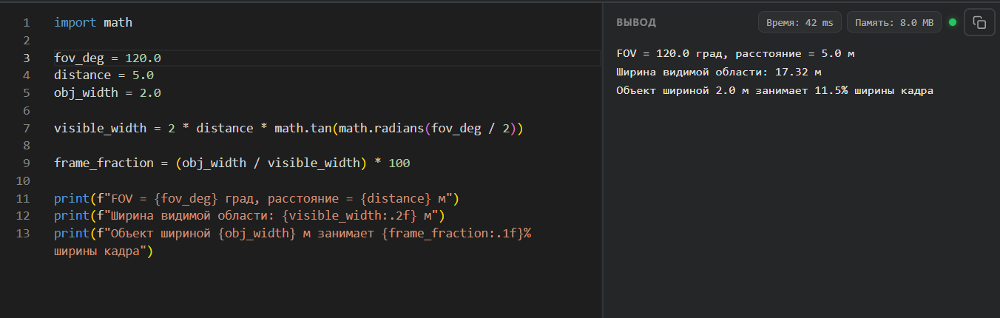

### Кейс 11. Кватернионы: поворот вектора взгляда
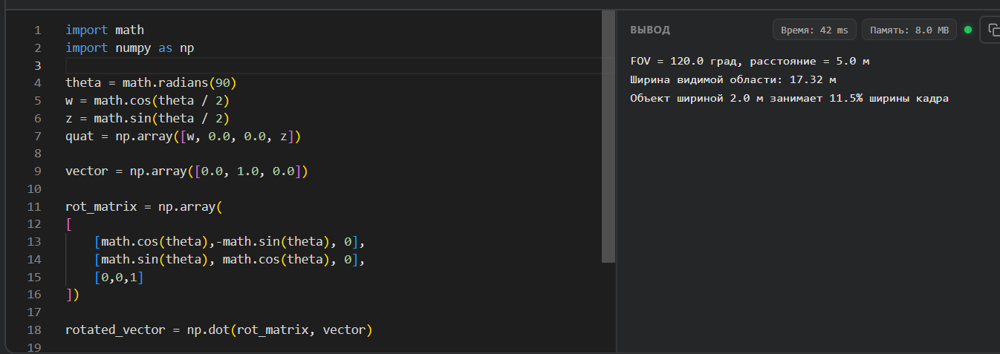

### Кейс 12. Бюджет кадра для частоты VR-дисплея
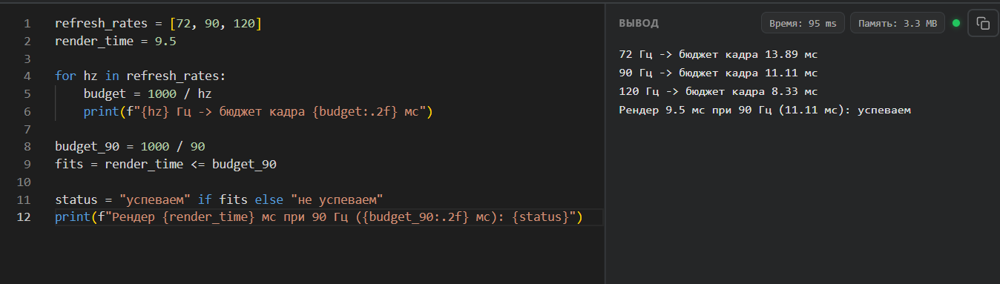

### Кейс 13. Выбор уровня детализации (LOD) по расстоянию
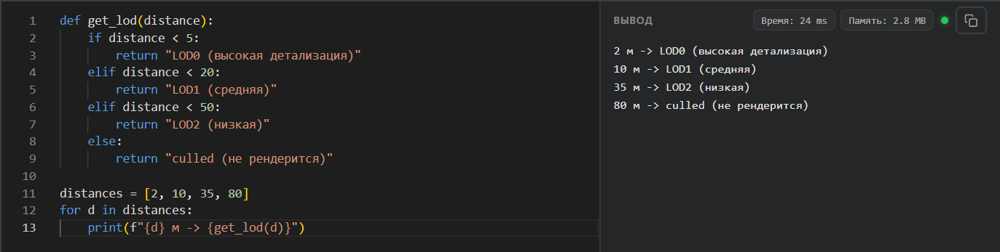

### Кейс 14. Полигональный бюджет VR-сцены
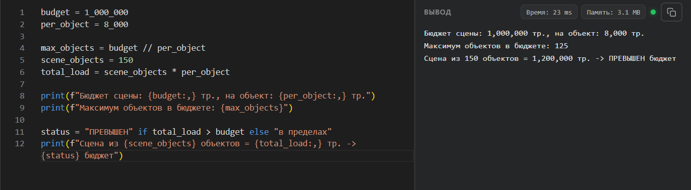

### Кейс 15. Задержка motion-to-photon
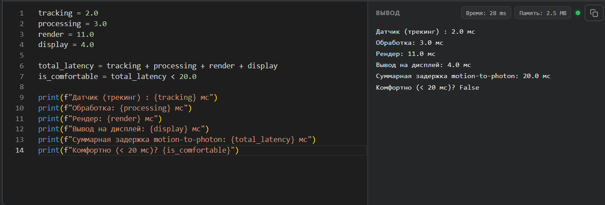